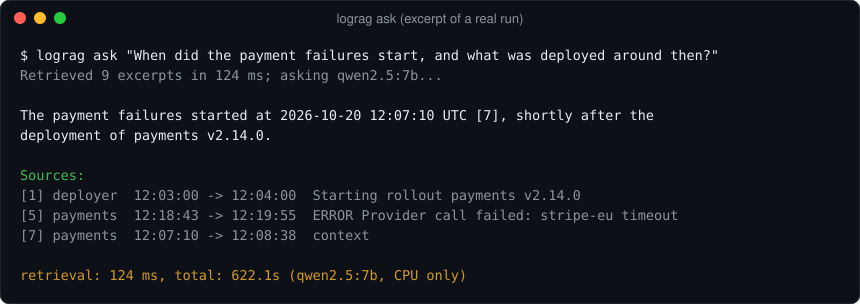
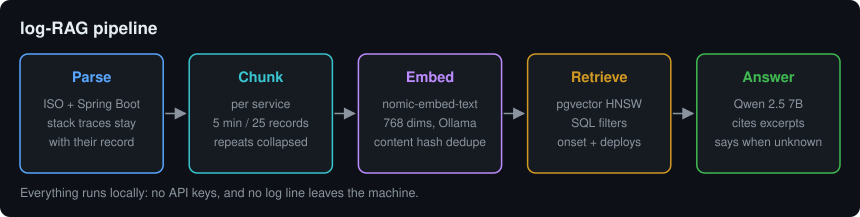

# log-RAG

**Ask questions about your logs in plain English, fully offline.**



log-RAG parses application logs, chunks them per service and time window, embeds
them with a local model, stores the vectors in PostgreSQL/pgvector, and answers
questions with a local LLM that must cite the log excerpts it used.

Nothing leaves the machine: no API keys, no data processing agreement, no
redaction pipeline. For an internal tool that reads production logs, that is
usually the whole argument.



## Stack

| Piece        | Choice                                     |
|--------------|--------------------------------------------|
| Embeddings   | `nomic-embed-text` (768 dims) via Ollama   |
| Answers      | `qwen2.5:7b` via Ollama (any chat model works) |
| Vector store | PostgreSQL 16 + pgvector, HNSW cosine index |
| Retrieval    | a SQL `ORDER BY embedding <=> query`       |
| Code         | Python 3.11, two dependencies (`psycopg`, `httpx`) |

## Quick start

```bash
docker compose up -d                                  # pgvector on :5442, Ollama on :11434
docker compose exec ollama ollama pull nomic-embed-text
docker compose exec ollama ollama pull qwen2.5:7b

python3 -m venv .venv && .venv/bin/pip install '.[dev]'
.venv/bin/python scripts/gen_logs.py                  # synthetic logs with a planted incident
.venv/bin/lograg ingest sample-logs
.venv/bin/lograg ask "Why are customers getting payment failures?"
```

Other commands: `lograg search` (retrieval only, no LLM), `lograg stats`,
`lograg reset`. Filters: `--service`, `--since`, `--until`, `--level ERROR`, `-k`.
Settings come from `LOGRAG_DSN`, `OLLAMA_URL`, `LOGRAG_EMBED_MODEL`, `LOGRAG_CHAT_MODEL`.

## How it works

1. **Parse.** ISO-style lines and Spring Boot's default console format. Stack
   traces and other continuation lines stay attached to the record that
   produced them.
2. **Chunk.** Retrieval quality depends far more on chunking than on model
   size, so the rules are strict: one service per chunk, bounded time window
   (5 min / 25 records / ~1,800 chars), an error never separated from its
   stack trace, and consecutive repeats collapsed into `(repeated xN)` so a log
   storm cannot drown everything else.
3. **Embed.** Each chunk gets a small metadata header (service, levels, time)
   and nomic's `search_document:` / `search_query:` task prefixes.
4. **Retrieve.** Cosine distance in SQL, combinable with ordinary `WHERE`
   filters on service, time and level.
5. **Explain *when*.** The best match is often not the first occurrence, so
   log-RAG looks for the **onset**: the earliest chunk of that service that
   still matches closely (and, if the match contains errors, that contains
   errors too — healthy traffic sharing the same words is not an onset). It
   then adds chunks from *other* services from 30 minutes before to 5 minutes
   after that moment, ranking deploys, rollbacks and config changes first.
   The window is lopsided on purpose: causes come before symptoms, and a bad
   release often surfaces 10–30 minutes after it lands.
6. **Answer.** The LLM sees numbered excerpts, must cite them like `[2]`, and
   is told to say so when the logs do not contain the answer.

Re-ingesting a file is a no-op: every chunk has a content hash, and only new
chunks are embedded.

## Example run

Real output from `qwen2.5:7b` on the synthetic logs below, unedited:

```
$ lograg ask "When did the payment failures start, and what was deployed around then?"
Retrieved 9 excerpts in 124 ms; asking qwen2.5:7b...

The payment failures started at 2026-10-20 12:07:10 UTC [7], shortly after the
deployment of payments v2.14.0.

Key points:
- Deployment of payments v2.14.0 occurred between 12:03:00 and 12:04:00 UTC on 2026-10-20 [1].
- Payment failures began at 12:07:10, which is about 4 minutes after the deployment started.
- The logs show multiple payment failures with Stripe EU provider starting from this timestamp.

retrieval: 124 ms, total: 622.1s (qwen2.5:7b)
```

It finds the right release and the right order of events, but the timestamp is
slightly off: 12:07:10 is where the cited chunk begins, and the first error in
that chunk is at 12:07:28. Check the cited excerpts before trusting a precise
time. The 10 minutes are CPU-only generation; retrieval takes about 0.1 s.

## Evaluation

`scripts/gen_logs.py` writes six hours of synthetic logs for five services
(12,632 records, deterministic seed) with a planted incident: a payments
release at 12:04 raises a provider timeout, checkout fails across three
services, and the release is rolled back at 12:51. A red-herring connection
pool warning and an unrelated later deploy are mixed in.

`scripts/eval_retrieval.py` asks 10 questions and checks whether the evidence
reaches the retrieved set:

| Setting (k = 6)            | Hit rate | Rank 1 |
|----------------------------|----------|--------|
| nomic-embed-text + pgvector | 10 / 10  | 8 / 10 |

The same 10/10 holds with temporal context disabled, so the context step does
not change the hit rate here; its job is to put the deploy next to the errors
in the prompt, so the model can connect cause and effect.

Measured on an Intel i9 laptop, CPU only, Ollama in Docker: ingesting the
12,632 records (553 chunks) took about 23 minutes, almost all of it embedding.
A GPU makes this dramatically faster.

## Tests

```bash
docker compose up -d db
.venv/bin/pytest -q
```

Unit tests cover parsing and chunking. Pipeline tests run against a real
pgvector database with a deterministic hashing embedder and a stub LLM, so CI
needs neither Ollama nor a GPU.

## Limits

- The 7B model is not GPT-class; it restates and connects evidence, it does not
  reason deeply. Retrieval does most of the work.
- It can quote a chunk's start time instead of the exact event (see the example run).
- Two log formats are parsed out of the box; others need a regex in `parse.py`.
- Synthetic logs are not production logs. Point it at your own and judge.

## License

MIT
