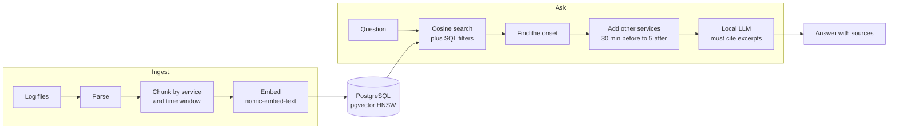
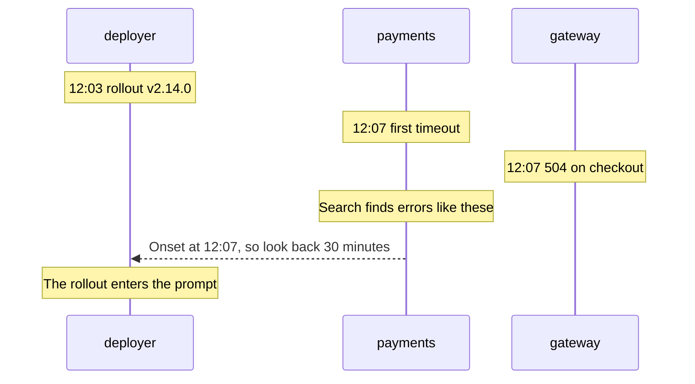

# log-RAG


During an incident you rarely know what to grep for. log-RAG lets you ask in plain
language, then answers from your logs and cites the lines it used. Everything runs
locally, so production logs never leave the machine.


## The problem

Sending production logs to a hosted LLM usually means a data processing agreement and
a redaction step, and sometimes it isn't allowed at all. A plain vector search has a
different weakness: it finds lines that look like the question, but the *cause* of an
incident is often in another service's logs, minutes earlier, using different words.

log-RAG handles both. It runs entirely offline, and after retrieving matches it finds
when the problem started and pulls in what other services were doing at that moment.

## Architecture



Why the context step exists:



## Design decisions

| Decision | Why | Trade-off |
|---|---|---|
| pgvector instead of a vector database | Search combines with ordinary `WHERE` filters, and teams already run PostgreSQL | Less tuning than a dedicated engine |
| Local models through Ollama | No data leaves the machine, no API keys | Slow on CPU: about 10 minutes per answer here |
| Strict chunking rules | Retrieval depends more on chunking than on model size | Two log formats out of the box |
| Errors stay with their stack traces | A split trace loses its meaning | Chunks vary in size |
| Repeats collapse into `(repeated xN)` | A log storm cannot drown everything else | Exact repeat timing is lost |
| Lopsided time window | Causes come before symptoms | Unrelated deploys can enter the prompt |
| Content hash on each chunk | Re-ingesting only embeds what is new | None worth mentioning |

## Stack

Python 3.11, PostgreSQL 16 with pgvector, Ollama (`nomic-embed-text`, `qwen2.5:7b`),
Docker Compose, GitHub Actions. Two runtime dependencies: `psycopg` and `httpx`.

## Quick start

```bash
docker compose up -d                                  # pgvector on :5442, Ollama on :11434
docker compose exec ollama ollama pull nomic-embed-text
docker compose exec ollama ollama pull qwen2.5:7b

python3 -m venv .venv && .venv/bin/pip install '.[dev]'
.venv/bin/python scripts/gen_logs.py                  # synthetic logs with a planted incident
.venv/bin/lograg ingest sample-logs
.venv/bin/lograg ask "Why are customers getting payment failures?"
```

Other commands: `lograg search` (retrieval only, no LLM), `lograg stats`,
`lograg reset`. Filters: `--service`, `--since`, `--until`, `--level ERROR`, `-k`.
Settings come from `LOGRAG_DSN`, `OLLAMA_URL`, `LOGRAG_EMBED_MODEL`, `LOGRAG_CHAT_MODEL`.

## Evaluation

`scripts/gen_logs.py` writes six hours of synthetic logs for five services
(12,632 records, deterministic seed) with a planted incident: a payments
release at 12:04 raises a provider timeout, checkout fails across three
services, and the release is rolled back at 12:51. A red-herring connection
pool warning and an unrelated later deploy are mixed in.

`scripts/eval_retrieval.py` asks 10 questions and checks whether the evidence
reaches the retrieved set:

| Setting (k = 6)            | Hit rate | Rank 1 |
|----------------------------|----------|--------|
| nomic-embed-text + pgvector | 10 / 10  | 8 / 10 |

The same 10/10 holds with temporal context disabled, so the context step does
not change the hit rate here; its job is to put the deploy next to the errors
in the prompt, so the model can connect cause and effect.

Measured on an Intel i9 laptop, CPU only, Ollama in Docker: ingesting the
12,632 records (553 chunks) took about 23 minutes, almost all of it embedding.
A GPU makes this dramatically faster.

## Example run

Real output, unedited apart from the excerpts:

```
The payment failures started at 2026-10-20 12:07:10 UTC [7], shortly after the
deployment of payments v2.14.0.

retrieval: 124 ms, total: 622.1s (qwen2.5:7b)
```

It found the right release and the right order of events, but the time is slightly
off: 12:07:10 is where the cited chunk begins, and the first error is at 12:07:28.
Check the cited lines before trusting an exact time.

## Tests

```bash
docker compose up -d db
.venv/bin/pytest -q
```

Unit tests cover parsing and chunking. Pipeline tests run against a real
pgvector database with a deterministic hashing embedder and a stub LLM, so CI
needs neither Ollama nor a GPU.

## Limits

- The 7B model is not GPT-class; it restates and connects evidence, it does not
  reason deeply. Retrieval does most of the work.
- It can quote a chunk's start time instead of the exact event (see the example run).
- Two log formats are parsed out of the box; others need a regex in `parse.py`.
- Synthetic logs are not production logs. Point it at your own and judge.

## License

MIT
